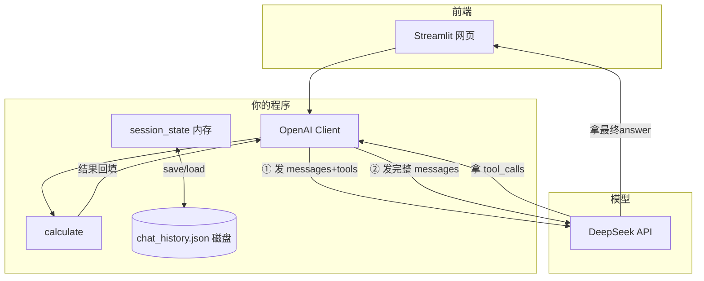

1.**概述**：一个基于 Streamlit 的个人 AI 助手，支持多轮对话、跨会话记忆（JSON 持久化）和函数调用（计算器工具），后端接 DeepSeek API。

2.**功能清单**：多轮对话/持久化记忆/工具调用（计算器）

3.**技术栈**：Streamlit · OpenAI SDK · DeepSeek API · Function Calling · python-dotenv

4.**架构图**：

5.**截图**:

6.**快速开始**:
pip install -r requirements.txt
# 复制 .env.example 为 .env，填入你的 DEEPSEEK_API_KEY
streamlit run app.py
